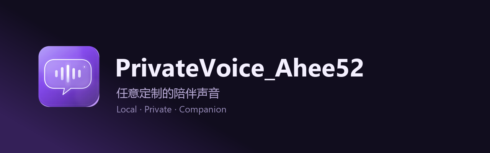

# PrivateVoice_Ahee52

**English** | [中文](README.zh.md)



**Any voice you want, living on your own machine. Train or clone the voice you have permission to use, speak the language you actually speak, and it answers in that voice — local ASR, local LLM, GPT-SoVITS v4. Audio never leaves your machine.**

Hold a hotkey, speak, and it answers in a cloned voice. Audio never leaves your machine.

> Author: **Ahee52**
> Status: **1.0.5**
> Packaged build: **PrivateVoice_Ahee52-1.0.5** — installer + 7 slices, 11.5 GB
> Install dir: `%ProgramFiles%\PrivateVoice_Ahee52`
> Config / logs: `<install>\config.yaml`, `<install>\logs\app.log`
> Models (installer): `<install>\GPT-SoVITS\GPT_SoVITS\pretrained_models`
> Models (source): `<repo>\models_cache` + `<repo>\GPT-SoVITS\...\pretrained_models`

---

## ⚠️ Before you start

**This is an emotional-companion app. It is not a medical device and not an emergency service.**
It does not replace family, friends, or professional care. If you or someone near you is in crisis,
contact local emergency services or a qualified professional.

**Cloning a voice requires explicit, revocable consent from its owner.**
The voice-cloning feature is meant for **your own voice**, or a voice you have **written permission** to use.

Explicitly prohibited:

- Impersonating anyone (relatives, public figures, support staff, authorities)
- Fraud, harassment, sexual content, or misleading material
- Cloning a voice without the owner's knowledge

You are responsible for complying with local law. The author accepts no liability for misuse.

---

## Why this exists

It started as a voice to keep me company on quiet nights.

After it worked, it looked useful for more people:

- **Elderly living alone** — someone to answer, remind them to take medicine, listen to old stories
- **People with limited mobility** — no need to get up or type; just speak
- **Anyone far from home** — at least the room is not silent after work
- **Visually impaired users / language learners** — voice-first, screen-optional

If you can adapt it to a real setting — elder care, community support, accessibility — **please do**.
That is the direction this project most wants to be used in.

---

## What is this repository?

A runnable project, not just an installer download page.

```text
app/               pipeline, ASR / LLM / TTS / player, training, UI, i18n
tools/             helper scripts (mic check, character check, packaging)
assets/prompts/    system prompts
docs/              stage reports and research notes
tests/             unit tests
installer.iss      Inno Setup packaging script
```

| Included | Not included |
|---|---|
| Full application code and bilingual UI | Model weights (≈2.6 GB, see the download table) |
| Training, QC and segmentation tooling | The LLM itself (any OpenAI-compatible endpoint) |
| Installer script | Character data and training artifacts |
| | Upstream GPT-SoVITS source (clone separately) |

---


## Repository layout

```text
app/            pipeline, ASR / LLM / TTS / player, training, UI, i18n
tools/          shipped helpers (run_upstream, selftest, llm_check, mic_check, check_character)
packaging/      Inno Setup script + Chinese language file (installer build)
scripts/        build_installer.ps1, make_update_zip.ps1, repo_check.ps1
scripts/dev/    one-off probes and experiments (not shipped)
docs/           stage reports, MODELS.md, screenshots (docs/assets)
tests/          unit tests
CHANGELOG.md    version history
NOTICE          third-party attribution
config.example.yaml
```

## Two ways to use it

| Route | For | Requires |
|---|---|---|
| **Installer** | End users | Download 8 files (one `.exe` + 7 `.bin`) from Releases |
| **Source** | Developers / explorers | Python 3.12, NVIDIA GPU, ~20 GB disk, model downloads |

The packaged build ships with a default voice and every model — install and talk. No Python needed.

---

## Hardware requirements

| Item | Minimum | Recommended |
|---|---|---|
| OS | Windows 10 x64 (21H2+) | Windows 11 x64 |
| GPU | NVIDIA RTX 2060 / 6 GB VRAM | **RTX 3090 / 4070 Ti / 5070 Ti, 16–24 GB** |
| Driver | CUDA 12.8 capable (≥ 570.x) | latest Game Ready / Studio |
| RAM | 16 GB | 32 GB |
| Disk | 15 GB free | 30 GB (multiple characters + training artifacts) |
| Audio | Any microphone | USB audio interface or headset with monitoring |
| Network | Not required to chat | Needed only for first model download / web lookup |

Notes:

- **Inference** needs roughly 6–8 GB VRAM. **Training** is comfortable on 24 GB; on 16 GB the app
  selects the balanced profile and lowers the batch size automatically.
- CPU-only inference is not supported (30–60 s per sentence, and v4 relies on GPU kernels).
- If VRAM is insufficient, training reports it instead of failing silently.

---

## Reproduce from source

### 0. Prerequisites

- Windows 10/11 x64
- Python **3.12** (the packaged build uses the embedded 3.12 runtime)
- Git, NVIDIA driver
- ~20 GB free disk

### 1. Get the code and upstream

```bash
git clone <this repo> PrivateVoice
cd PrivateVoice

# The upstream inference stack is not vendored
git clone https://github.com/RVC-Boss/GPT-SoVITS.git
```

> `Aqua-TTS` is only used by the legacy v3 engine (`AquaTTSEngine` in `app/core/tts.py`).
> The default v4 pipeline does not need it.

### 2. Install dependencies

```bash
python -m venv .venv
.venv\Scripts\activate

# torch must match your CUDA; the packaged build uses cu128
pip install torch==2.11.0 torchaudio==2.11.0 --index-url https://download.pytorch.org/whl/cu128

pip install -r requirements.txt
```

### 3. Download models

All paths are **relative to the project root**; the app loads them from exactly these locations:

```text
PrivateVoice\
├─ GPT-SoVITS\
│  └─ GPT_SoVITS\pretrained_models\
│     ├─ s1v3.ckpt                                       148 MB
│     ├─ gsv-v4-pretrained\s2Gv4.pth                     733 MB
│     ├─ gsv-v4-pretrained\vocoder.pth                    55 MB
│     ├─ chinese-roberta-wwm-ext-large\pytorch_model.bin  621 MB
│     └─ chinese-hubert-base\pytorch_model.bin           180 MB
├─ models_cache\
│  ├─ modelscope\models\        ← Chinese ASR (FunASR auto-download)
│  └─ whisper\faster-whisper-small\   ← English / multilingual ASR (optional)
└─ nltk_data\                   ← cmudict / POS data (needed for English speech)
```

#### 3.1 Automatic (recommended)

Start the app; in the first-run wizard choose language → GPU check → **pick an ASR model** →
click **“Download missing models”**. The manifest lives in
[`app/core/models.py`](app/core/models.py) and shows progress.

#### 3.2 Manual

| Model | Purpose | Size | Source | Place under |
|---|---|---|---|---|
| `s1v3.ckpt` | GPT / T2S backbone | 148 MB | [HF lj1995/GPT-SoVITS](https://huggingface.co/lj1995/GPT-SoVITS) | `GPT-SoVITS/GPT_SoVITS/pretrained_models/` |
| `s2Gv4.pth` | v4 SoVITS | 733 MB | same repo, `gsv-v4-pretrained/` | `…/pretrained_models/gsv-v4-pretrained/` |
| `vocoder.pth` | 48 kHz vocoder | 55 MB | same repo | same folder |
| `chinese-roberta-wwm-ext-large` | text front-end | 621 MB | [HF hfl](https://huggingface.co/hfl/chinese-roberta-wwm-ext-large) | `…/pretrained_models/chinese-roberta-wwm-ext-large/` |
| `chinese-hubert-base` | semantic features | 180 MB | [HF TencentGameMate](https://huggingface.co/TencentGameMate/chinese-hubert-base) | `…/pretrained_models/chinese-hubert-base/` |
| `paraformer-zh` + `ct-punc` + `campplus` | **Chinese ASR (default)** | ≈1.2 GB | [ModelScope iic](https://modelscope.cn/models/iic/speech_seaco_paraformer_large_asr_nat-zh-cn-16k-common-vocab8404-pytorch) | let FunASR write into `models_cache/modelscope/models/` |
| `faster-whisper-small` | **English / multilingual ASR (optional)** | 484 MB | [HF Systran](https://huggingface.co/Systran/faster-whisper-small) | `models_cache/whisper/faster-whisper-small/` |

### 4. Run

```bash
python app/main.py
```

The wizard asks for language → GPU → models → LLM endpoint. Any OpenAI-compatible API works,
for example a local llama.cpp server:

```yaml
llm:
  base_url: "http://127.0.0.1:8082/v1"
  model: "Qwen3.5-9B"
  api_key: ""        # usually empty for local servers
```

### 5. Verify

```bash
python tools/mic_check.py            # microphone and playback devices
python tools/check_character.py 默认音色   # character files and weights
```

Logs: `logs/app.log`.

---

## Chinese vs English ASR

Two ASR routes are built in **and both ship with the installer**. Switch in
**Settings → Speech recognition** (restart to apply); Chinese users keep paraformer,
English/multilingual users pick whisper.

| | Chinese paraformer-zh | English whisper-small |
|---|---|---|
| Strength | Best Chinese accuracy, natural punctuation, speaker check | English / Japanese / Korean, mixed language |
| Size | ≈1.2 GB | ≈461 MB |
| VRAM | ≈0.8 GB | ≈1 GB |
| Switch | “Chinese paraformer” in the wizard | “English / multilingual whisper” |

Resulting `config.yaml`:

```yaml
asr:
  model: "paraformer-zh"      # or "whisper"
  whisper_size: "small"
```

Both may be installed; only the selected one loads. Choose whisper if you code-switch mid-sentence.

---

## Features

- **Push-to-talk**: default `shift+a`, configurable to any combo (a single modifier works too)
- **Fully local pipeline**: ASR → LLM → GPT-SoVITS v4, no audio uploaded
- **zh / en / ja / ko / yue** speech, language detected per sentence
- **Character training**: 45 s – 5 min of audio → QC → segmentation → LoRA → 3-sentence self-test
- **Voice & pacing panel**: speed, sentence gap, voice temperature, top-k, sampling steps,
  repetition penalty — each with a short explanation
- **Optional web lookup**: Bing / Baidu / Wikipedia, with a “let me check” pre-sentence
- **Bilingual UI**: chosen on first run, switchable from the main window or the tray

---

## FAQ

**No sound after installing?**
Check `logs/app.log` for `TTS 失败`. Confirm the character folder has both weight files under `checkpoints/`.

**Training reports insufficient VRAM?**
Models are unloaded before training; if it still fails, use cleaner/longer material or the conservative profile.

**“Already running”?**
The app is single-instance — check the system tray.

**Can I copy a character from another machine?**
Yes: copy the whole folder (`profile.json`, `reference.wav/.txt`, `checkpoints/`, `dataset/`) into
`characters/`; the index rebuilds automatically. Do not rename weight files.

**Voice drags a syllable?**
Raise “repetition penalty” to 1.9–2.1 in the character page; if it persists, lower speed to 0.92.

---

## On voice consent (again)

- Before training, confirm the voice is **yours**, or you hold **written permission**
- Permission should state purpose, scope, duration, and allow revocation at any time
- Never use synthetic speech for impersonation, fraud, harassment, sexual content, or misleading claims
- For products or public services, complete the disclosure and compliance required by local law

---

## License

This project's code is **MIT** — see [LICENSE](LICENSE).

Dependencies and weights keep their own licenses: GPT-SoVITS (MIT), FunASR (MIT),
faster-whisper (MIT), CTranslate2 (MIT), PySide6 (LGPLv3, dynamically linked),
ModelScope (Apache-2.0), and the chinese-roberta / chinese-hubert / paraformer / whisper
weights under their publishers' terms.

---

## Credits

- [GPT-SoVITS](https://github.com/RVC-Boss/GPT-SoVITS) — voice cloning and synthesis
- [FunASR](https://github.com/modelscope/FunASR) — Chinese speech recognition
- [faster-whisper](https://github.com/SYSTRAN/faster-whisper) — multilingual recognition
- [PySide6](https://www.qt.io/qt-for-python) — UI
- [HuggingFace](https://huggingface.co) / [ModelScope](https://modelscope.cn) — model hosting

---

## One last thing

It began as a voice in the night.
If it can keep an elderly person company, help someone who cannot type, or make a quiet
apartment after overtime feel less empty — it has done more than a TTS demo ever could.

**May there be peace, and may companionship be everywhere.**


### Building the installer (maintainers)

```powershell
powershell -ExecutionPolicy Bypass -File scripts\build_installer.ps1
powershell -ExecutionPolicy Bypass -File scripts\make_update_zip.ps1 -Version 1.0.5
powershell -ExecutionPolicy Bypass -File scripts\repo_check.ps1   # before pushing
```

See [packaging/README.md](packaging/README.md) and [docs/MODELS.md](docs/MODELS.md).


## Support

If this project saved you some time, you can [buy me a coffee](https://ko-fi.com/ahee52).
